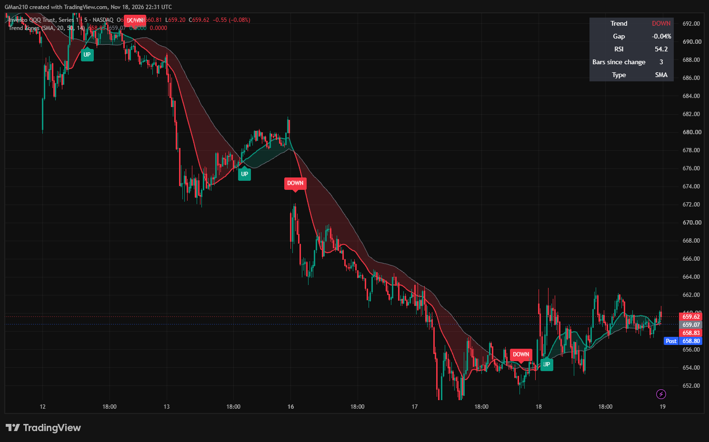

# Trend Zones – TradingView Indicator

A clean, configurable trend indicator for TradingView, written in Pine Script v6.

It shows trend direction with two moving averages, shades the zone between them, labels trend changes confirmed by RSI momentum, and sends alerts when the trend turns.

## Features

- **Trend lines:** fast and slow moving averages, coloured by trend direction
- **EMA or SMA:** switch average type from the settings
- **Shaded trend zone** between the two averages
- **RSI confirmation:** labels only appear when momentum agrees with the cross (can be switched off)
- **Info panel:** current trend, gap between averages, RSI, bars since the last change and average type
- **Alerts:** "Trend turned up" and "Trend turned down", ready to use in TradingView's alert menu
- **Fully configurable:** lengths, colours, labels and shading

## How to use

1. Open a chart on TradingView and click **Pine Editor**.
2. Paste in the contents of `trend_zones.pine`.
3. Click **Add to chart**.
4. Adjust the settings with the gear icon on the indicator.
5. To get notified, open **Create alert** and choose *Trend turned up* or *Trend turned down*.

## Settings

| Setting | Default | What it does |
|---|---|---|
| Average type | EMA | Exponential or simple moving average |
| Fast length | 20 | Bars used for the fast average |
| Slow length | 50 | Bars used for the slow average |
| Confirm labels with RSI | On | Only label crosses that RSI agrees with |
| RSI length | 14 | Bars used for RSI |
| Show labels / Shade zone | On | Turn visual elements on or off |
| Colours | Teal / Red | Uptrend and downtrend colours |

## Custom tools

I build custom TradingView indicators, strategies, alerts and Python backtests. Get in touch via GitHub.

## Disclaimer

This tool is for educational and informational purposes only. It is not financial advice and does not recommend buying or selling any security. Past patterns do not guarantee future results.
